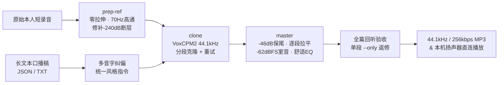

<div align="center">

# Natural Voice Clone (`natural-voice-clone`)

**零电音、自然舒适的本人音色中文长文本配音工作流 & AI Agent Skill**

[](LICENSE)
[](requirements.txt)
[](#核心架构与流程)
[](SKILL.md)

简体中文 · [English](README.en.md) · [踩坑与声学依据](docs/workflow-and-pitfalls.md)

</div>

---

同一段本人参考录音，有人克隆出来一听就是「电音 + 营销号 AI 味」，有人克隆出来却像在录音棚里对着大振膜话筒面对面聊天。差距往往不在模型参数量，而在 **参考音频处理、模型声码器选型、风格一致性控制、多音字纠偏与克制母带** 五个环节。

`natural-voice-clone` 把经过实测验证的完整流程封装为 **可独立运行的 Python CLI** 与 **即装即用的 AI Agent Skill（`SKILL.md`）**，无需本地昂贵独显，零 `atempo` 相位损伤，直接生成 **44.1 kHz / 256 kbps、零电音、耳感舒适** 的影视飓风/播客级中文长口播。

## 为什么这套流程听起来更像真人？

| 常见 AI 味 / 电音来源 | 传统做法踩过的坑 | `natural-voice-clone` 的解法 |
| :--- | :--- | :--- |
| **电音与相位毛刺** | 参考音频先做 `atempo` 变速、压缩或 MP3 二次重编再送去克隆，WSOLA 相位毛刺被 1:1 放大 | **`prep-ref` 零破坏预处理**：原样无损解码，严禁对参考段变速/压缩/染色，仅去直流、70 Hz 高通与断层修补 |
| **声码器高频金属感** | 24 kHz / 12 Hz 离散码本模型长段生成易带颗粒与金属味 | **首选 VoxCPM2（44.1 kHz 连续扩散）**，天生无离散码本电音；支持独立 GPU `Qwen3-TTS 1.7B` 作为备选 |
| **固定 TTS 营销号味** | 用固定公共发音人或逐段换不同情绪提示词，导致塑料感或段间变声 | **仅提本人声纹 + 全篇统一自然风格指令**，保留个人底色并自然演绎面对面聊天呼吸感 |
| **句间「真空黑洞」** | 拼接处出现 `-240 dB` 纯数字零，人耳瞬间识破静音门与硬切 | **`-46 dB` 保尾音淡出 + `-62 dBFS` 连续棚拍室音托底**（语音段自动闪避），全篇如同一场录音 |
| **笔记本外放刺耳** | 后期生硬拉高 `2–4 kHz` 临场感或套假混响，外放发刺发空 | **耳感舒适克制母带**：不加混响、不硬提 2–4 kHz，仅轻去 300 Hz 盒音、柔压 6.8 kHz 齿音，`1.35:1` 柔压缩至 `-15.5 LUFS` |
| **多音字与吞字** | 科技词「校准」常误读为 `xiào`；整篇重跑耗时 | 内置多音字替字映射 + JSON `say` 字段 + `--only 5,6` **精准单段重配** |
| **Windows 播放踩坑** | `Start-Process` 弹默认应用框、`ffplay` 中文路径闪退 | `play` 子命令自动转纯 ASCII 临时 WAV，通过 `sounddevice` 直连系统扬声器并验活 |

## 核心架构与流程



## 快速开始

### 1. 环境要求
- **Python >= 3.10**
- **FFmpeg**（已加入系统 `PATH`）
- 依赖安装：
  ```bash
  pip install -r requirements.txt
  ```

### 2. 作为 AI Agent Skill 安装（Antigravity / T3 Code / Claude Code 等）

```bash
# Antigravity 全局 Skill 目录（Windows PowerShell）
git clone https://github.com/yutianchenc-create/natural-voice-clone.git "$env:USERPROFILE\.gemini\config\skills\natural-voice-clone"

# macOS / Linux
git clone https://github.com/yutianchenc-create/natural-voice-clone.git ~/.gemini/config/skills/natural-voice-clone
```

安装后新开会话，直接对 Agent 说：
> “用我的参考录音，按影视飓风风格读一下这份稿子，去 AI 味、自然舒适，做完在电脑上放给我听。”

### 3. 作为独立 CLI 运行

```bash
# 1) 环境与远程引擎自检
python scripts/voice_pipeline.py doctor

# 2) 一键端到端生成（默认 VoxCPM2 + 影视飓风自然风格 + 声学报告 + 播完验收）
python scripts/voice_pipeline.py run my_voice.mp3 examples/sample_script.json out.mp3 --style mediastorm --report --play
```

#### 分步执行 & 单段精准返修（推荐长稿使用）

```bash
# 第一步：制备零拉伸纯净参考段（44.1 kHz，头 0.08s，尾 0.05s）
python scripts/voice_pipeline.py prep-ref my_voice.mp3 work/ref_pure.wav --engine voxcpm2

# 第二步：分段克隆（内置 mediastorm / podcast / defense 三种预设，或用 --instruction 自定义）
python scripts/voice_pipeline.py clone work/ref_pure.wav examples/sample_script.json work --style mediastorm

# 第三步：舒适无电音母带混音 + 声学质检
python scripts/voice_pipeline.py master work out.mp3 --report

# 如试听发现第 4 段多音字或语气不理想，仅重配第 4 段再重新混音：
python scripts/voice_pipeline.py clone work/ref_pure.wav examples/sample_script.json work --only 4
python scripts/voice_pipeline.py master work out.mp3 --report

# 本机扬声器可靠直连播放（彻底规避 OpenWith 弹窗与中文路径闪退）
python scripts/voice_pipeline.py play out.mp3
```

## 脚本文件格式

支持纯文本 `.txt`（自动按 40–75 字切段）或结构化 `.json`（推荐，支持 `say` 多音字覆写与精确 `pause` 停顿）：

```json
{
  "title": "科技分享口播示例",
  "artist": "your-channel",
  "segments": [
    {
      "id": 1,
      "text": "其实很多人一直都有一个误解，觉得想把音频做好，就非得花大价钱买昂贵设备不可。听起来挺合理的，对吧？",
      "pause": 0.44
    },
    {
      "id": 2,
      "text": "只要用算法把基础链路校准好，普通设备也能输出很干净的声音。",
      "say": "只要用算法把基础链路较准好，普通设备也能输出很干净的声音。",
      "pause": 0.32
    }
  ]
}
```

## 开源致谢与说明

- 本项目工作流在开源社区基础上整合优化，致谢 [OpenBMB / VoxCPM](https://github.com/OpenBMB/VoxCPM)、[Qwen3-TTS](https://github.com/QwenLM/Qwen3-TTS)、[FFmpeg](https://ffmpeg.org/) 以及中文口播去 AI 味开源实践的启发。
- 远程推理地址可通过环境变量 `NVC_VOXCPM2_URL` / `NVC_QWEN3_URL` 指向你自托管的本地或云端 Gradio 实例。
- **合规提醒**：仅限用于克隆**本人声音**或**已获得明确授权的声音**，请遵守所在地区关于合成语音标识与声音权益的相关法律法规。

## License

Released under the [MIT License](LICENSE).
